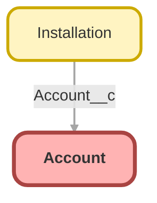

<!-- This file is auto-generated. if you do not want it to be overwritten, set TRUE in the line below -->
<!-- DO_NOT_OVERWRITE_DOC=FALSE -->

# Account

## Schema

<!-- Object description -->

## Fields

| Name | Label | Type | Description |
| :-------- | :---- | :--: | :---------- | 
| AccountNumber |  |  | <!-- --> |
| AccountSource |  | Picklist | <!-- --> |
| Active__c | Active | Picklist | <!-- --> |
| AnnualRevenue |  |  | <!-- --> |
| BillingAddress |  |  | <!-- --> |
| ChannelProgramLevelName |  |  | <!-- --> |
| ChannelProgramName |  |  | <!-- --> |
| CustomerPriority__c | Customer Priority | Picklist | <!-- --> |
| Description |  |  | <!-- --> |
| Fax |  |  | <!-- --> |
| First_Sale_Date__c | First Sale Date | Date | Date of first Closed/Won Opportunity. |
| Industry |  | Picklist | <!-- --> |
| IsCustomerPortal |  |  | <!-- --> |
| IsPartner |  |  | <!-- --> |
| Jigsaw |  |  | <!-- --> |
| Name |  |  | <!-- --> |
| NumberOfEmployees |  |  | <!-- --> |
| NumberofLocations__c | Number of Locations | Number | <!-- --> |
| OwnerId |  | Lookup | <!-- --> |
| Ownership |  | Picklist | <!-- --> |
| ParentId |  | Hierarchy | <!-- --> |
| Phone |  |  | <!-- --> |
| Rating |  | Picklist | <!-- --> |
| ShippingAddress |  |  | <!-- --> |
| Shoe_of_the_Month_Subscriber__c | Shoe of the Month Subscriber | Checkbox | Currently subscribed to Shoe of the Month club. |
| Sic |  |  | <!-- --> |
| SicDesc |  |  | <!-- --> |
| Site |  |  | <!-- --> |
| SLA__c | SLA | Picklist | <!-- --> |
| SLAExpirationDate__c | SLA Expiration Date | Date | <!-- --> |
| SLASerialNumber__c | SLA Serial Number | Text | <!-- --> |
| TickerSymbol |  |  | <!-- --> |
| Tier |  |  | <!-- --> |
| Type |  | Picklist | <!-- --> |
| UpsellOpportunity__c | Upsell Opportunity | Picklist | <!-- --> |
| Website |  |  | <!-- --> |

## Related Profiles

| Profile | User License |
| :----      | :--: | 
| [Admin](../profiles/Admin.md) | Salesforce |
| [Chatter Free User](../profiles/Chatter%20Free%20User.md) | Chatter Free |
| [Chatter Moderator User](../profiles/Chatter%20Moderator%20User.md) | Chatter Free |
| [ContractManager](../profiles/ContractManager.md) | Salesforce |
| [Cross Org Data Proxy User](../profiles/Cross%20Org%20Data%20Proxy%20User.md) | XOrg Proxy User |
| [Custom%3A Marketing Profile](../profiles/Custom%253A%20Marketing%20Profile.md) | Salesforce |
| [Custom%3A Sales Profile](../profiles/Custom%253A%20Sales%20Profile.md) | Salesforce |
| [Custom%3A Support Profile](../profiles/Custom%253A%20Support%20Profile.md) | Salesforce |
| [Customer Community Login User](../profiles/Customer%20Community%20Login%20User.md) | Customer Community Login |
| [Customer Community User](../profiles/Customer%20Community%20User.md) | Customer Community |
| [Helios Crew](../profiles/Helios%20Crew.md) | Salesforce |
| [MarketingProfile](../profiles/MarketingProfile.md) | Salesforce |
| [Partner Community Login User](../profiles/Partner%20Community%20Login%20User.md) | Partner Community Login |
| [Partner Community User](../profiles/Partner%20Community%20User.md) | Partner Community |
| [Read Only](../profiles/Read%20Only.md) | Salesforce |
| [SolutionManager](../profiles/SolutionManager.md) | Salesforce |
| [Standard](../profiles/Standard.md) | Salesforce |

## Related Permission Sets

| Permission Set | User License |
| :----      | :--: | 
| [Helios_Delivery_Crew](../permissionsets/Helios_Delivery_Crew.md) | None |
| [Helios_Delivery_Manager](../permissionsets/Helios_Delivery_Manager.md) | None |

_Documentation generated with [sfdx-hardis](https://sfdx-hardis.cloudity.com), by [Cloudity](https://www.cloudity.com/) & [friends](https://github.com/hardisgroupcom/sfdx-hardis/graphs/contributors)_
