<!-- This file is auto-generated. if you do not want it to be overwritten, set TRUE in the line below -->
<!-- DO_NOT_OVERWRITE_DOC=FALSE -->

# Case

## Schema

```mermaid
graph TD
Case["Case"]:::mainObject
click Case "../Case/"


classDef object fill:#D6E9FF,stroke:#0070D2,stroke-width:3px,rx:12px,ry:12px,shadow:drop,color:#333;
classDef customObject fill:#FFF4C2,stroke:#CCAA00,stroke-width:3px,rx:12px,ry:12px,shadow:drop,color:#333;
classDef customObjectManaged fill:#FFD8B2,stroke:#CC5500,stroke-width:3px,rx:12px,ry:12px,shadow:drop,color:#333;
classDef mainObject fill:#FFB3B3,stroke:#A94442,stroke-width:4px,rx:14px,ry:14px,shadow:drop,color:#333,font-weight:bold;

```

<!-- Object description -->

## Fields

| Name | Label | Type | Description |
| :-------- | :---- | :--: | :---------- | 
| AccountId |  | Lookup | <!-- --> |
| AssetId |  | Lookup | <!-- --> |
| BusinessHoursId |  | Lookup | <!-- --> |
| ClosedDate |  |  | <!-- --> |
| Comments |  |  | <!-- --> |
| ContactEmail |  |  | <!-- --> |
| ContactFax |  |  | <!-- --> |
| ContactId |  | Lookup | <!-- --> |
| ContactMobile |  |  | <!-- --> |
| ContactPhone |  |  | <!-- --> |
| Description |  |  | <!-- --> |
| EngineeringReqNumber__c | Engineering Req Number | Text | <!-- --> |
| IsClosedOnCreate |  |  | <!-- --> |
| IsEscalated |  |  | <!-- --> |
| IsSelfServiceClosed |  |  | <!-- --> |
| IsVisibleInSelfService |  |  | <!-- --> |
| Origin |  | Picklist | <!-- --> |
| OwnerId |  | Lookup | <!-- --> |
| ParentId |  | Lookup | <!-- --> |
| PotentialLiability__c | Potential Liability | Picklist | <!-- --> |
| Priority |  | Picklist | <!-- --> |
| Product__c | Product | Picklist | <!-- --> |
| Reason |  | Picklist | <!-- --> |
| SLAViolation__c | SLA Violation | Picklist | <!-- --> |
| Status |  | Picklist | <!-- --> |
| Subject |  |  | <!-- --> |
| SuppliedCompany |  |  | <!-- --> |
| SuppliedEmail |  |  | <!-- --> |
| SuppliedName |  |  | <!-- --> |
| SuppliedPhone |  |  | <!-- --> |
| Type |  | Picklist | <!-- --> |

## Related Assignment Rules

| Assignment Rule | Is Active |
|     :----       |  :--: | 
| [Case.Standard](../assignmentRules/Case.Standard.md) | true |

## Related Escalation Rules

| Escalation Rule | Is Active |
|     :----       |  :--: | 
| [Case.Standard](../escalationRules/Case.Standard.md) | true |

## Related Profiles

| Profile | User License |
| :----      | :--: | 
| [Admin](../profiles/Admin.md) | Salesforce |
| [Chatter Free User](../profiles/Chatter%20Free%20User.md) | Chatter Free |
| [Chatter Moderator User](../profiles/Chatter%20Moderator%20User.md) | Chatter Free |
| [ContractManager](../profiles/ContractManager.md) | Salesforce |
| [Cross Org Data Proxy User](../profiles/Cross%20Org%20Data%20Proxy%20User.md) | XOrg Proxy User |
| [Custom%3A Marketing Profile](../profiles/Custom%253A%20Marketing%20Profile.md) | Salesforce |
| [Custom%3A Sales Profile](../profiles/Custom%253A%20Sales%20Profile.md) | Salesforce |
| [Custom%3A Support Profile](../profiles/Custom%253A%20Support%20Profile.md) | Salesforce |
| [Customer Community Login User](../profiles/Customer%20Community%20Login%20User.md) | Customer Community Login |
| [Customer Community User](../profiles/Customer%20Community%20User.md) | Customer Community |
| [Helios Crew](../profiles/Helios%20Crew.md) | Salesforce |
| [MarketingProfile](../profiles/MarketingProfile.md) | Salesforce |
| [Partner Community Login User](../profiles/Partner%20Community%20Login%20User.md) | Partner Community Login |
| [Partner Community User](../profiles/Partner%20Community%20User.md) | Partner Community |
| [Read Only](../profiles/Read%20Only.md) | Salesforce |
| [SolutionManager](../profiles/SolutionManager.md) | Salesforce |
| [Standard](../profiles/Standard.md) | Salesforce |

_Documentation generated with [sfdx-hardis](https://sfdx-hardis.cloudity.com), by [Cloudity](https://www.cloudity.com/) & [friends](https://github.com/hardisgroupcom/sfdx-hardis/graphs/contributors)_
