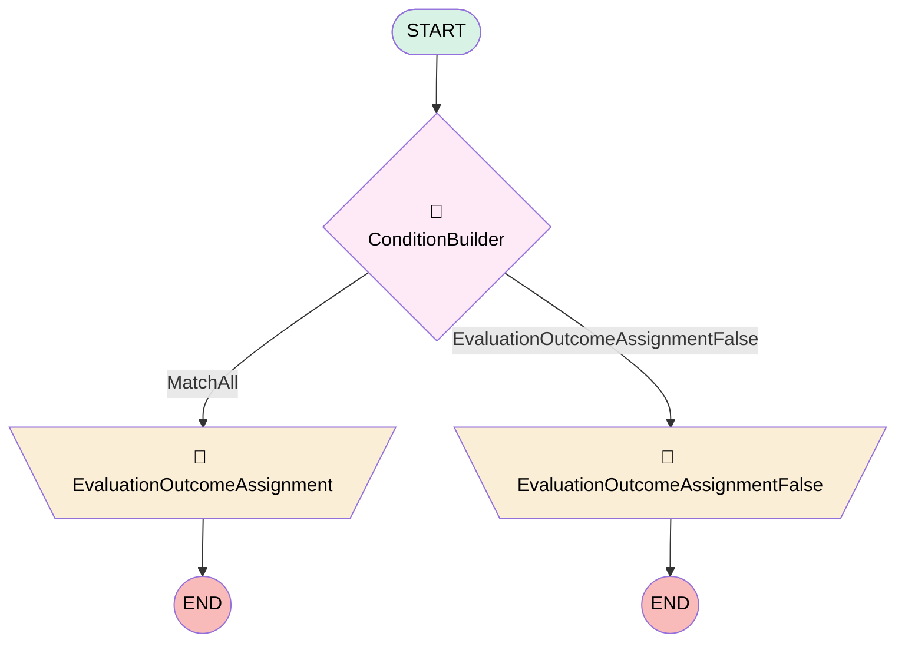

# The default Report Export Policy Flow.

## Flow Diagram [(_View History_)](sfdc_default_ReportExport_Protection_Flow-history.md)

<!-- Flow description -->

## General Information

|<!-- -->|<!-- -->|
|:---|:---|
|Process Type|Transaction Security Flow|
|Label|The default Report Export Policy Flow.|
|Status|⚠️ Draft|
|Description|The default Condition Builder flow for the default ReportEvent Transaction Security Policy.|
|Start Element Reference|[ConditionBuilder](#conditionbuilder)|

## Variables

|Name|Data Type|Is Collection|Is Input|Is Output|Object Type|Description|
|:-- |:--:|:--:|:--:|:--:|:--:|:--  |
|EvaluationOutcome|Boolean|⬜|⬜|✅|<!-- -->|<!-- -->|
|myVariable_myEvent|SObject|⬜|✅|⬜|ReportEvent|<!-- -->|

## Flow Nodes Details

### EvaluationOutcomeAssignment

|<!-- -->|<!-- -->|
|:---|:---|
|Type|Assignment|
|Label|[EvaluationOutcomeAssignment](#evaluationoutcomeassignment)|

#### Assignments

|Assign To Reference|Operator|Value|
|:-- |:--:|:--: |
|EvaluationOutcome|Assign|✅|

### EvaluationOutcomeAssignmentFalse

|<!-- -->|<!-- -->|
|:---|:---|
|Type|Assignment|
|Label|[EvaluationOutcomeAssignmentFalse](#evaluationoutcomeassignmentfalse)|

#### Assignments

|Assign To Reference|Operator|Value|
|:-- |:--:|:--: |
|EvaluationOutcome|Assign|⬜|

### ConditionBuilder

|<!-- -->|<!-- -->|
|:---|:---|
|Type|Decision|
|Label|[ConditionBuilder](#conditionbuilder)|
|Default Connector|[EvaluationOutcomeAssignmentFalse](#evaluationoutcomeassignmentfalse)|
|Default Connector Label|[EvaluationOutcomeAssignmentFalse](#evaluationoutcomeassignmentfalse)|

#### Rule MatchAll (MatchAll)

|<!-- -->|<!-- -->|
|:---|:---|
|Connector|[EvaluationOutcomeAssignment](#evaluationoutcomeassignment)|
|Condition Logic|(1 OR 2) AND 3|

|Condition Id|Left Value Reference|Operator|Right Value|
|:-- |:-- |:--:|:--: |
|1|myVariable_myEvent.Operation|Equal To|ReportExported|
|2|myVariable_myEvent.Operation|Equal To|ReportExportedUsingExcelConnector|
|3|myVariable_myEvent.RowsProcessed|Greater Than|10000|

___

_Documentation generated from branch monitoring_d700000009o68eae_dev_ed by [sfdx-hardis](https://sfdx-hardis.cloudity.com), featuring [salesforce-flow-visualiser](https://github.com/toddhalfpenny/salesforce-flow-visualiser)_